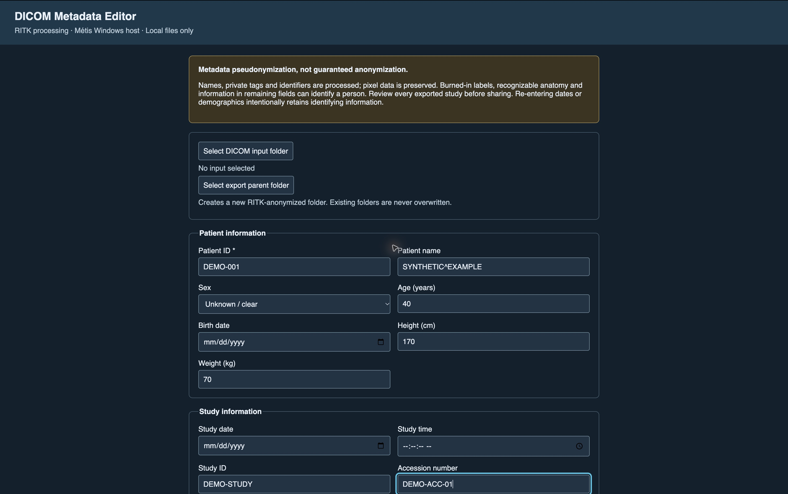
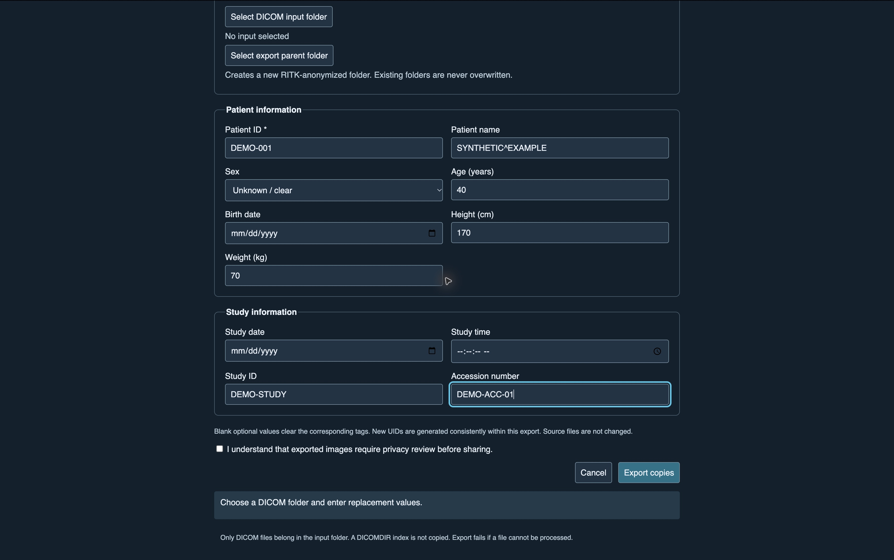

# RITK DICOM Metadata Editor: Windows user manual

**Unreleased candidate · 12 November 2026 · application revision af866ec1**

## Read this first

This program edits selected DICOM metadata in **exported copies**. It uses RITK
for processing and Métis for its Windows desktop interface. It is a
**pseudonymization tool, not a guarantee of complete de-identification**.

Pixel data is unchanged. Names burned into an image, recognizable anatomy,
remaining attributes (including information inside sequences), and demographics
that you enter may identify someone. The output sets Patient Identity Removed
to `NO`. The directory name `RITK-anonymized` is not a privacy certification.
Do not share a study until the appropriate privacy review is complete. Start
with synthetic test data, not clinical data.

**About these screenshots:** these are genuine captures of the application's
unchanged HTML form rendered in Chrome on macOS, with synthetic values typed
into it. They illustrate controls and field entry, not a running Windows host.
Windows folder dialogs and a completed native export could not be captured:
no Windows computer was connected. No successful export has been staged or
simulated in these pictures. Date controls, fonts, and window layout may differ
on Windows. Opening the HTML file in a browser does **not** run the program;
folder selection and export require the Windows executable.



*Figure 1. Privacy notice, folder controls and patient fields. No folder has
been selected in this browser-rendered reference.*

## 1. Obtain and start the Windows candidate

1. Open [draft PR #898](https://github.com/ryancinsight/ritk/pull/898).
2. For the tested application revision, open the
   [successful Windows build](https://github.com/ryancinsight/ritk/actions/runs/43260489947).
   Under Artifacts, download `ritk-dicom-editor-windows-candidate`.
   GitHub may require sign-in. This is a development artifact, not an installer
   or a published release; artifacts can expire.
3. Extract the ZIP into a dedicated folder. Locate `ritk-anonymizer.exe`.
   The Microsoft Edge WebView2 Runtime is required. If unavailable, obtain it
   through your organization's approved Microsoft installation process.
4. Launch **the executable**, not `editor.html`. The candidate was built on a
   Windows x64 hosted runner. Native installation and interaction acceptance
   are still pending; do not bypass organizational warnings or controls.
5. If the application immediately closes, start it from PowerShell in the
   extracted folder to retain its diagnostic output:

   ```powershell
   .\ritk-anonymizer.exe
   ```

Developers with the repository and its toolchain can instead run:

```powershell
cargo run --locked -p ritk-anonymizer --release
```

## 2. Prepare one consistent batch

- Put only DICOM instance files in an input folder, including any desired
  subfolders. The program scans recursively; file extensions are not a filter.
- Use a single intended patient/study batch. **Every file receives the same
  entered replacement values.** The form does not read the source values into
  its fields or detect that mixed patients should use different replacements.
- Keep originals backed up. Do not include ZIPs, PDFs, notes or unrelated files.
  `DICOMDIR` index files are skipped; symbolic links are rejected.
- The limit is 100,000 instance files per batch. There must be at least one.
  Duplicate SOP Instance UIDs are rejected rather than silently collapsed.
- Choose an existing, writable export parent **outside the input tree** with
  adequate free space. For example, use `C:\DICOM-Demo\Exports\Run-01` as the
  parent. These paths are illustrative, not an existing folder on your computer.

## 3. Select source and destination

1. Click **Select DICOM input folder**, choose the input directory in the native
   Windows folder dialog, then confirm. Its path should appear below the button.
2. Click **Select export parent folder**, choose the export parent, then confirm.
   The displayed destination appends `RITK-anonymized` to that parent.
3. Confirm both displayed paths before continuing. Canceling a dialog does not
   select a new path. To avoid confusion, re-open the dialog if the displayed
   path is not the one you intended.
4. The `RITK-anonymized` child directory must **not already exist**. For another
   run, choose a different empty parent, such as `Run-02`. Do not remove existing
   results merely to satisfy this check.

If neither folder button opens a dialog, verify that you launched the Windows
EXE rather than the HTML reference. If you did launch the EXE, stop there and
report its build revision and observed behavior. A folder path appearing only
in documentation is not a selected input.

## 4. Enter replacement metadata

**Patient ID is required. Every other field is optional. Blank means clear the
corresponding output tag, not preserve the original.** Choose the minimum data
needed for your approved use. The example values below are invented training
values; they should not be reused as a real patient identity.

| Field | How to enter it | Synthetic example / effect |
|---|---|---|
| Patient ID | Nonblank printable ASCII, at most 64 characters | `DEMO-001` |
| Patient name | At most 64 printable ASCII characters; DICOM PN syntax uses `^` between components | `SYNTHETIC^EXAMPLE`, or blank to clear |
| Sex | Male, Female, Other, or Unknown / clear | Unknown / clear writes an empty value |
| Age (years) | Whole number from 0 through 999, or blank | `40` becomes `040Y` |
| Birth date | Valid date using the date control, or blank | Blank clears; retaining a birth date increases identifiability |
| Height (cm) | Positive finite number, decimal point if needed | `170` is stored as `1.7` metres |
| Weight (kg) | Positive finite number, decimal point if needed | `70` remains 70 kilograms |
| Study date | Valid date using the date control, or blank | No automatic relationship with birth date or age |
| Study time | Valid clock time using the control, optionally seconds | 14:30:00; no timezone or fractional seconds |
| Study ID | At most 16 printable ASCII characters | `DEMO-STUDY` |
| Accession number | At most 16 printable ASCII characters | `DEMO-ACC-01` |

Text values cannot include a backslash, newline, or non-ASCII character in this
candidate. Names allow up to five `^`-separated components per group and up to
three `=`-separated groups, within the total 64-character limit. Height and
weight must fit DICOM decimal precision; simplify excessive decimal digits.
The editor validates formats, not medical plausibility or consistency between
age, birth date and study date. Date/time appearance follows local controls;
use their displayed format rather than assuming month/day ordering.



*Figure 2. Synthetic patient and study values in the actual form, rendered in a
browser. Dates are intentionally blank, the privacy acknowledgment is unchecked,
and no export has run.*

## 5. Export copies

1. Review both paths and all replacement values. Remember that one set of values
   applies to every instance in this batch.
2. Read and check **I understand that exported images require privacy review
   before sharing.** This acknowledgment is not certification of the results.
3. Click **Export copies** once. During processing, controls are disabled.
   The status area reports that copies are being exported.
4. Wait for the completion message reporting the exported file count. A red
   error message is failure, not partial success. Do not force-quit the process.
5. **Cancel** closes the editor before a batch starts. It is not an active-batch
   cancel command. Closing the native window during export waits for the worker;
   the window closing alone does not prove the export succeeded.

The new folder contains neutral names such as `instance-000001.dcm`. Original
names, folder hierarchy and the DICOMDIR index are not copied. The Enhanced
metadata profile runs first, then the entered replacements are applied. Private
tags and identifiers are processed by that profile; this is not an assertion
that every possible identifying attribute or nested object has been removed.
UIDs are remapped consistently within the batch with a fresh random salt for
each export. Separate exports are not guaranteed to use matching UIDs. Exported
files are reopened to check replacements, SOP identity and unchanged pixels.

## 6. Verify before using or sharing

- Confirm the success message and expected instance count.
- Inspect the new directory. **If `INCOMPLETE` is present, do not use or share it.**
  A crash or failed cleanup can leave this marker and partial files. Absence of
  the marker alone is not proof that a study is anonymous or clinically valid.
- Open output copies in an appropriate DICOM viewer. Check all series and the
  required tags, references and image appearance. Keep originals separate.
- Review pixels for burned-in names, dates and labels; review recognizable
  anatomy and remaining metadata, including nested sequences and free text.
- Follow your organization's de-identification and downstream validation
  requirements. Do not send real patient samples or identifying logs when
  reporting a bug; use synthetic reproductions.

## 7. Troubleshooting

| Symptom or message | What to do |
|---|---|
| Folder buttons do nothing | Launch the Windows EXE, not the HTML. If still broken, report the build and behavior; do not assume a folder was imported. |
| Patient ID is required | Enter a nonblank replacement ID. Spaces alone are invalid. |
| Invalid date/time or value | Correct the indicated field. Use a real calendar date and clock time; simplify decimals. |
| Output must be a new directory with an existing parent | Choose a writable existing parent without a `RITK-anonymized` child; retain previous outputs. |
| Input instance is not readable DICOM | Check for non-DICOM, corrupt or unsupported files; use a separate clean input copy and investigate the file. |
| Missing or duplicate SOP Instance UID | Investigate the source batch; do not silently discard instances or invent identifiers to suppress the error. |
| Input contains a symbolic link | Use regular DICOM files in a dedicated input folder. |
| Export worker stopped / incomplete output | Do not use the output. Preserve diagnostic information without patient data and investigate before retrying into a new parent. |
| App will not start | Check WebView2 and the candidate's Windows architecture; run from PowerShell to see the error. Do not disable security controls. |

## Validation status and screenshot provenance

Application revision `af866ec1ef772dc108dd52f0508f898998059fbb` passed 72 backend
anonymization tests and an optimized Windows build in run `43260489947`.
Independent source review found no remaining concrete blockers at that revision.
This is **not** evidence that native folder selection, WebView2 messaging,
Windows dialogs, DPI behavior, or clinical use have been validated.

The two images were captured from `src/editor.html` without modifying the page
or injecting host messages. Only synthetic text was entered. Native Windows
usage screenshots and end-to-end synthetic export acceptance remain outstanding
until a connected Windows environment is available and the candidate is exercised.
