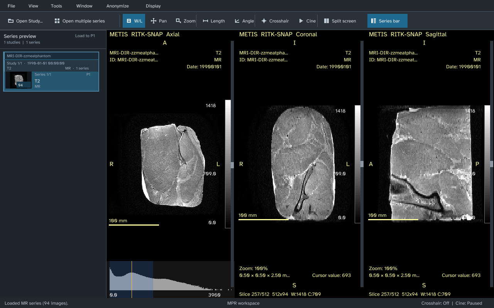
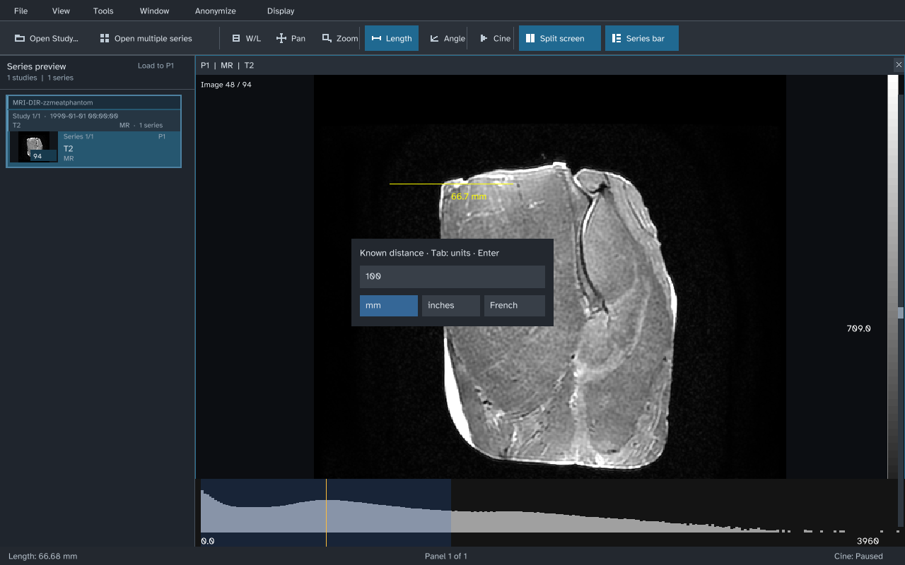
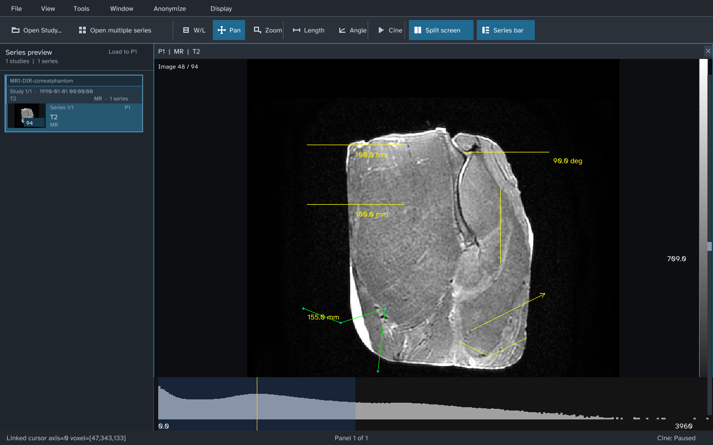

# AsterSlice user manual

Use AsterSlice to browse a study and measure or mark an image on Windows.
The executable is `asterslice`; its Cargo package is `ritk-snap`. The
[feature comparison](features.md) covers the supplied RadiAnt 2021.2 manual,
the current Windows controls, the tests, and the work needed for parity.
The [developer reference](development.md) contains reproduction procedures
and historical captures.

## Launch and open a study

From a RITK source checkout, build and start AsterSlice with a DICOM folder.

```powershell
cargo run --locked -p ritk-snap -- path/to/study
```

Without a startup path, the Windows application opens a folder picker.
In an open viewer, choose **File → Open Study...** or **Ctrl+O** to replace
the current study. Pick a folder containing the DICOM files. Use the series
browser to select an acquisition from a study containing several series.

For a known example, use the public MRI phantom included in the repository.

```powershell
cargo run --locked -p ritk-snap -- test_data/2_head_mri_t2/DICOM
```

A startup path can also name a DICOM instance or DICOMDIR. To select a series
explicitly from a study folder, add `--series-instance-uid UID`. The [launch reference](../../crates/ritk-snap/README.md)
describes startup selection and capture options.

- [Adjust the image display](#adjust-the-image-display)
- [Compare series](#compare-series)
- [Scroll through a slice stack](#scroll-through-a-slice-stack)
- [Measure a length and calibrate it](#calibrate-a-length-on-one-image)
- [Measure angles and regions](#measure-an-angle-or-a-region-of-interest)
- [Draw and edit polygons](#trace-an-open-path-and-a-closed-outline)
- [Draw an arrow or a freehand mark](#draw-an-arrow)
- [Windows tool shortcuts](#windows-tool-shortcuts)

## Adjust the image display

Use **W/L**, **Pan**, or **Zoom** on the toolbar to choose the left-button
gesture. Drag within the image to apply it. On Windows, the active drag stays
captured until release, including when the pointer leaves the viewer. The
**Display** menu offers the loaded modality's window presets, inversion, and
color maps. Number keys apply available presets; **I** inverts and **Shift+C**
cycles the color map. Custom presets currently last for the running
application.

Pan distance and zoom/window drag sensitivity currently depend on image fit
and orientation. The [navigation correction](../../backlog/RITK-SNAP-NAVIGATION-UNITS-001.md)
tracks this known limitation; menu presets and slice rails remain available.

Press **H** or **V** to flip the image horizontally or vertically.
**R** rotates clockwise by 90 degrees and **Shift+R** rotates the other way.
**Shift+O** restores image orientation. **Ctrl+0** fits the image to its pane;
the **Display → Zoom 1:1** preset maps the slice's largest physical pixel
spacing to one screen pixel. Square pixels therefore map one image texel to
one screen pixel, while anisotropic pixels retain their physical aspect.
The measurement and orientation overlays follow the displayed image.

In three-plane MPR, **View → Toggle clinical overlay** shows or hides the
corner text. **View → Toggle anonymized overlay** hides the identity text in
those corners. To create a de-identified study copy, use the **Anonymize**
menu. **File → Repair Study Copy...** writes a corrected study copy.
The [study-copy procedures](development.md#export-a-de-identified-study-or-series)
describe their selection, output, and failure behavior.

## Compare series

Choose **Window → Open multiple series...** or press **F4** to select series.
Choose **Window → Panel layout...** to arrange the panes. Click a pane to
make it active. **Tab** and **Shift+Tab** move between panes; each pane's
slice rail acts on that pane's series.

Use **Ctrl+M** to maximize or restore the active pane, **Ctrl+F4** to close
it, or **Shift+F4** to close all panes. Choose **Window → Three-plane MPR**
to return to the axial, coronal, and sagittal views.

Choose **Tools → Crosshair**, then click an image to place a visible linked
cursor in all three MPR panes. Choose **Pan** to move without hiding the cursor.

Patient-position synchronization and cross-reference lines between different
series remain [linking work](features.md#reading-and-annotations).

## Try the Windows slice and annotation tools

Open the public T2 phantom at `test_data/2_head_mri_t2/DICOM` in the default
Windows viewer. The steps below also work on another multi-slice DICOM
series with image spacing. Use **Window → Three-plane MPR** to show axial,
coronal, and sagittal views together.

### Scroll through a slice stack

1. Grab the scrollbar thumb at the right edge of an image pane and drag it
   toward the bottom. Watch the pane's image number and the anatomy change.
2. Drag above the track and release. The pane stops at its first slice.
   Drag below the track to reach the last slice.
3. Click the track away from the thumb to jump to that position. In the
   three-plane layout, repeat in another pane and compare the slice readouts.
   The scrollbar changes the slice of its own pane without panning the image.

The image corners show the image count, window width and centre, and
displayed frame dimensions. When clinical text runs out of room, the viewer shortens long
corner labels with an ellipsis. Resize the window to compare the corner
readouts and orientation letters in wide and narrow panes. Colorbar values
have their own rows. Measurement labels move to stay visible inside the pane.



### Measure a length and a deviation

1. Choose **Tools → Length** or press **L**. Hold the left button on a
   landmark, then drag toward another landmark in the same image. The line follows the
   pointer while the button is down. Release to show the length in millimetres
   beside the line.
2. Try the same length as two left clicks. You can make a display adjustment
   with a button assigned to **W/L**, **Zoom**, or **Pan** between the clicks.
   The first endpoint stays in place. You can also drag after placing the
   first endpoint to complete the measurement.
3. Choose **Tools → Pan** or press **M**. Drag either endpoint of a completed
   length to change the measurement. Drag the line away from its endpoint
   handles to move the complete mark without changing its measured value or
   image calibration. The preview follows the pointer; release to keep it or
   press **Esc** to retain the last committed position.
4. Choose **Tools → Deviation** or press **D**. Drag a slanted segment
   in the image and release. The overlay shows the segment and its reference along the closer
   image axis. Its label gives the perpendicular offset in millimetres and
   the angle from that axis in degrees.
5. Scroll to another slice and back. The measurements appear on the slice
   where you drew them.

### Calibrate a length on one image

1. Measure a reference of known length with **Tools → Length**.
2. Choose **Tools → Calibrate last distance…**. Enter the known distance in
   millimetres and press **Enter**. **Esc** cancels.
3. Check the labels on that image. If a 5 mm reading is calibrated to
   10 mm, a 3 mm reading on that image becomes 6 mm.
4. Scroll to another slice and back. Choose **Tools → Reset length
   calibration** on the reference image to restore image-spacing readings.



Calibration lasts for the loaded study. Reopen the study to restore its DICOM
spacing. This control currently rescales ordinary Length labels only.
Patient-space lengths, deviation, polygon values, and ROI areas retain their
image-spacing values. Inch/French-size input and source-specific calibration
colors remain [calibration work](features.md#reading-and-annotations).

### Measure an angle or a region of interest

1. Choose **Tools → Angle** or press **A**. Click a point on the first arm,
   the vertex, and a point on the second arm. Read the included angle in degrees.
2. Choose **Tools → ROI Rect** or **ROI Ellipse**. **E** also selects ROI
   Ellipse. Drag between opposite corners of the bounding box and release. The
   overlay shows mean intensity, standard deviation, and area in square millimetres.
3. Choose **Tools → HU Point** and click a voxel to mark its numeric intensity.

### Measure a Cobb angle

Choose **Tools → Cobb Angle** or press **C**. Drag the first line and release.
Drag a second line on the same slice. The viewer draws both lines and reports
the smaller angle between their physical directions in degrees. Press **Esc**
to cancel an unfinished measurement. **Shift+C** cycles the display colormap.

### Trace an open path and a closed outline

1. Press **O** or choose **Tools → Open Polygon**. Click at least two
   landmarks along a path, then press **Enter**. The label gives the sum of
   the segment lengths in millimetres. **Shift+O** resets image orientation.
2. Choose **Tools → Closed Polygon** or press **G**. Place at least three
   vertices around an outline and press **Enter**, or click near the
   starting vertex to close it. The overlay reports area in square
   millimetres and perimeter in millimetres.

Double-click the final vertex to finish either path after placing its minimum
number of vertices. Choose another tool to discard an unfinished path.

### Select, move, and delete a polygon

1. Choose **Tools → Pan** or press **M**, then left-click the edge of a completed polygon
   without holding a modifier key. Cross-shaped handles appear at its
   vertices. You can select a closed polygon by its closing edge.
2. Press and drag one handle. The outline previews the new shape. Release
   within the image to keep the new shape and update the length or the
   area and perimeter. Press **Esc** during the drag to keep the
   original shape. The same happens if pointer capture is lost.
3. Press an already-selected segment away from its handles to insert a node
   on the projected segment. Keep holding the button to drag that new node;
   release commits the updated measurement. Pressing a handle takes priority,
   and endpoint clicks do not add duplicate nodes.
4. Scroll off the source slice and return to it to see that the mark stays
   with its image. Select its edge again and press **Delete** to remove it.
   Marks on other slices stay in place.

### Draw an arrow

Choose **Tools → Arrow** or press **Y**. Drag from the tail to the tip and
release. Press **Esc** during the drag to cancel. Scroll off the image and
back to see that the completed arrow belongs to the image where you drew it.

### Draw a freehand mark

Choose **Tools → Pencil** or press **P**. Hold the left button and trace
a feature. Release to keep the mark on that slice. Press **Esc** during
the drag to discard the unfinished stroke.

### Windows tool shortcuts

| Key | Tool |
| --- | --- |
| **M** | Pan |
| **L** | Length |
| **D** | Deviation |
| **A** / **C** | Angle / Cobb Angle |
| **E** | ROI Ellipse |
| **O** / **G** | Open Polygon / Closed Polygon |
| **Y** | Arrow |
| **P** | Pencil |
| **Shift+C** | Cycle the display colormap |



The figures show the native Windows viewer's client area with the public T2
phantom loaded. See the [capture inputs and image digests](images/dicom-native-annotations.json).

## Feature and test coverage

The [feature comparison](features.md) records current native workflows,
processing-only capabilities, missing controls, and required tests against
RadiAnt 2021.2. Use it when checking a capability before relying on the
viewer for a particular workflow. Capture and test commands are in the
[developer reference](development.md#run-the-reference-checks).
